# Fanatic Museum - 서브컬처 대장정

[](https://github.com/ryushin01/Fanatic-Museum/actions/workflows/ci.yml)


애니메이션, 게임, 라이트 노벨, 판타지 소설, 만화·웹툰, 피규어, 프라모델까지. 한 사람의 서브컬처 대장정을 소장품처럼 번호를 붙여 전시하는 박물관입니다.

**[전시실 바로 보기](https://fanatic-museum-ryushin01.vercel.app/)** · [Storybook](https://fanatic-museum-ryushin01.vercel.app/storybook/index.html) · [정적 API](https://fanatic-museum-ryushin01.vercel.app/api/works.json)

> **프로젝트 상태:** 포트폴리오 프로젝트입니다. 작품 이미지의 저작권은 각 저작권자에게 있어, 고화질 이미지는 관리자 컴퓨터에만 보관하고 공개 사이트에는 작품 번호와 대표색으로 만든 자리 표시 그래픽을 보여 줍니다. 이미지를 받는 곳과 글꼴의 출처는 아래 [출처](#출처)에 모았습니다.

## 화면

| 홈                                                                                               | 소장품 목록                                                              |
| ------------------------------------------------------------------------------------------------ | ------------------------------------------------------------------------ |
| 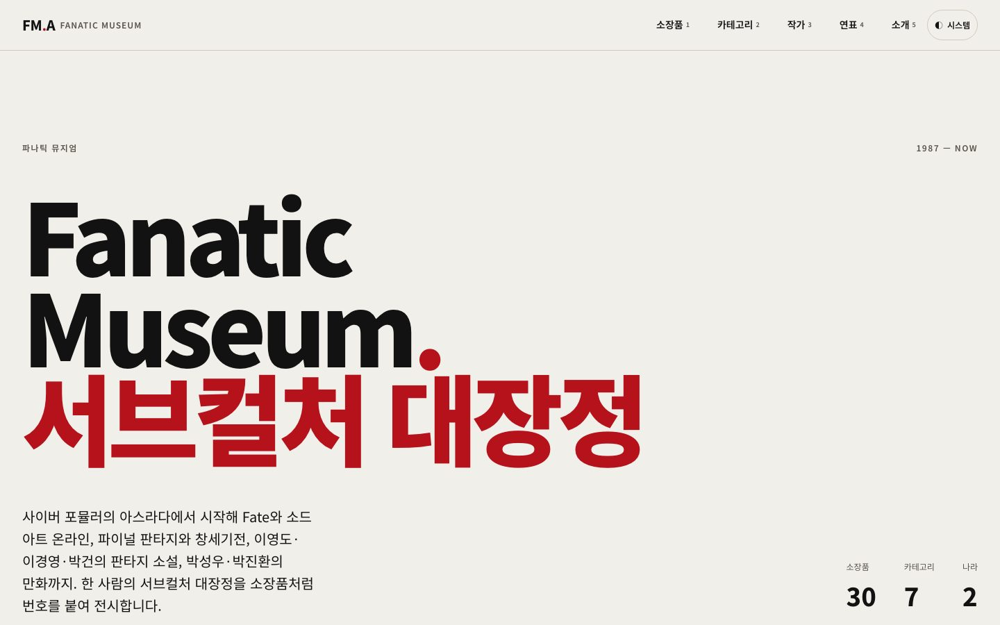 | 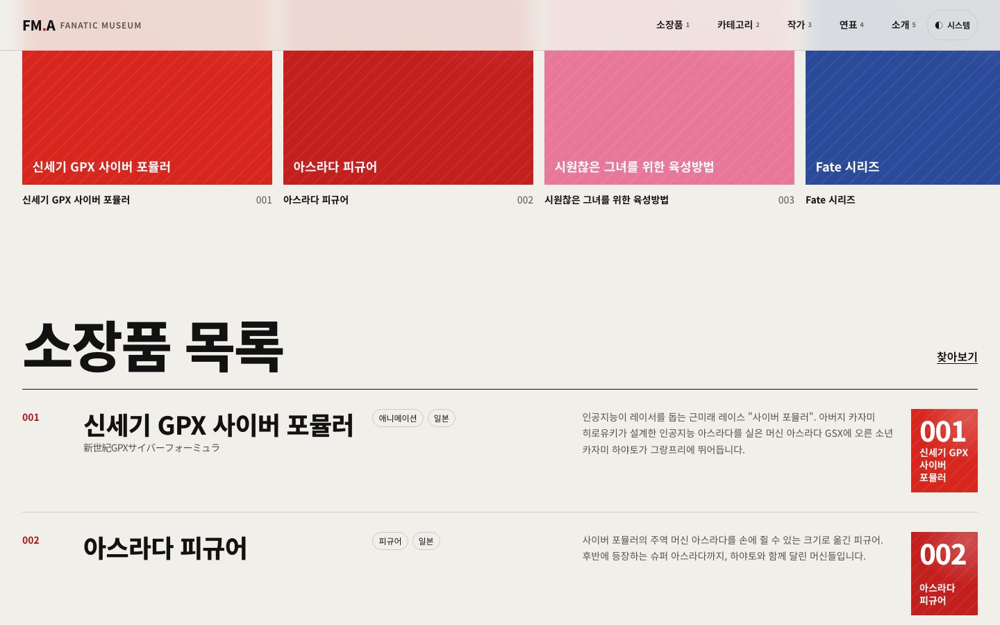 |

| 작품 상세                                                                      | 소장품 찾기                                                                  |
| ------------------------------------------------------------------------------ | ---------------------------------------------------------------------------- |
| 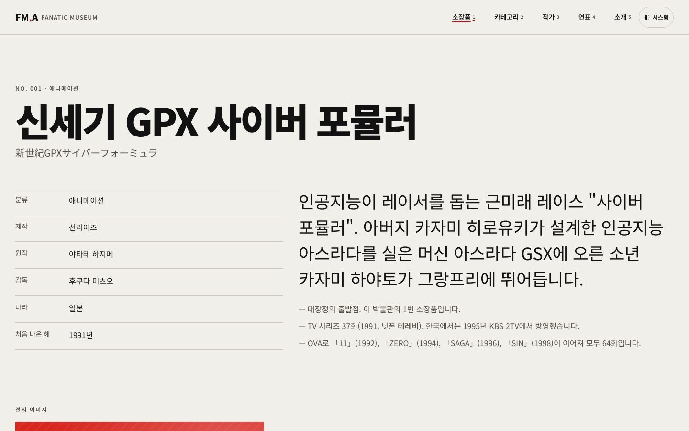 | 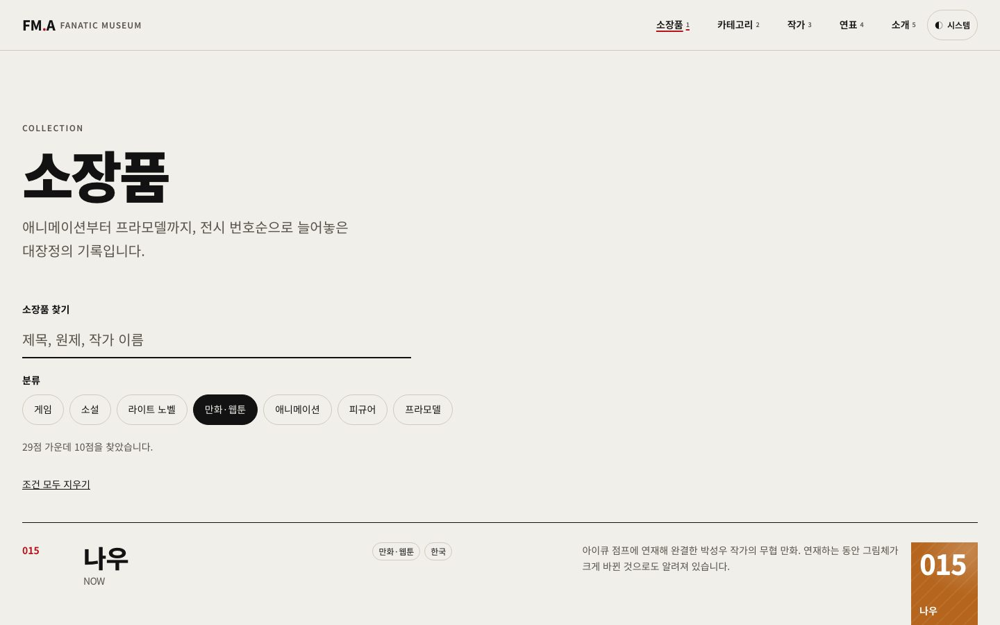 |

| 대장정 연표                                                       | 작가                                                                          |
| ----------------------------------------------------------------- | ----------------------------------------------------------------------------- |
| 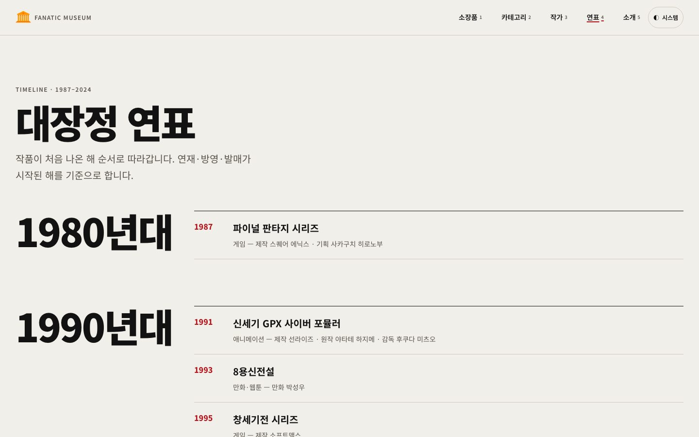 | 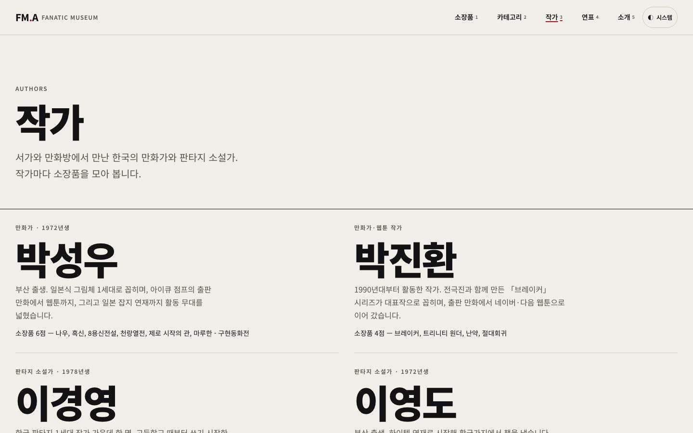 |

| 모바일 홈                                                                                  | 모바일 작품 상세                                                                    | 모바일 다크 모드                                                                           |
| ------------------------------------------------------------------------------------------ | ----------------------------------------------------------------------------------- | ------------------------------------------------------------------------------------------ |
| 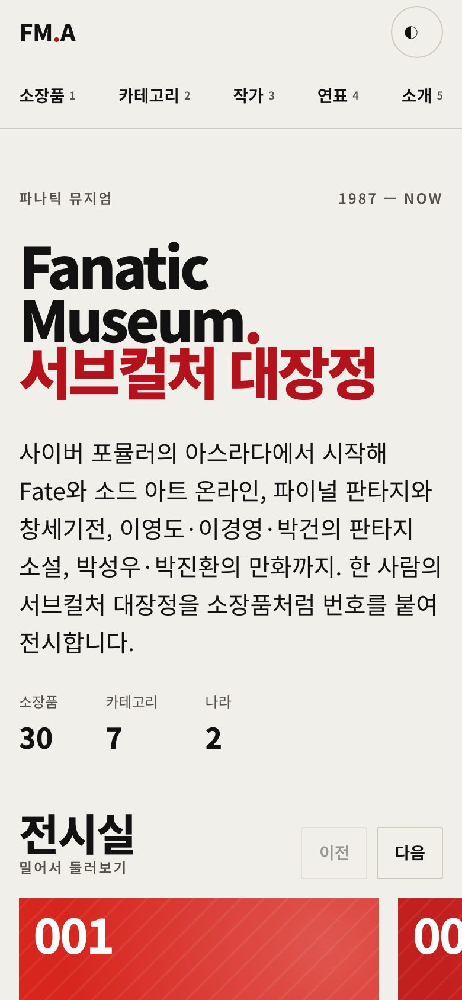 | 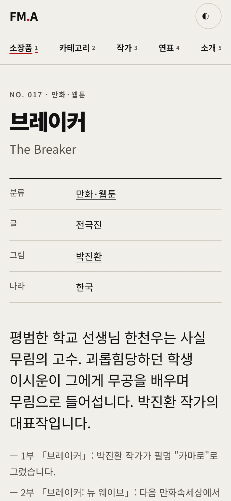 | 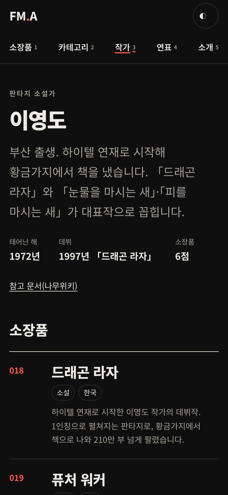 |

| 홈 전시관 (스크롤)                                                                                                                                     | 모바일 전시관                                                                                                 |
| ------------------------------------------------------------------------------------------------------------------------------------------------------ | ------------------------------------------------------------------------------------------------------------- |
| 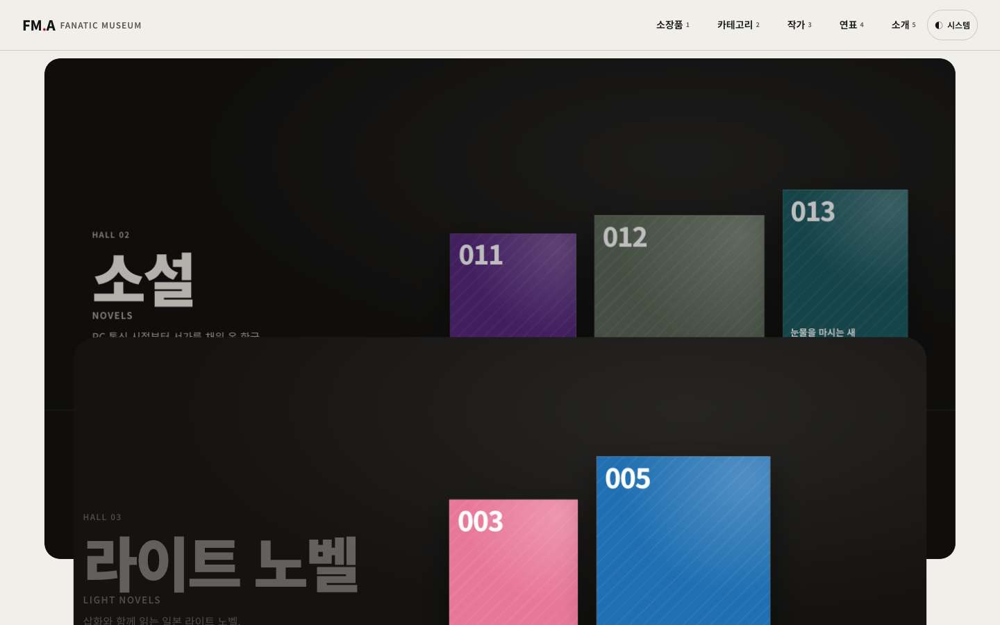 | 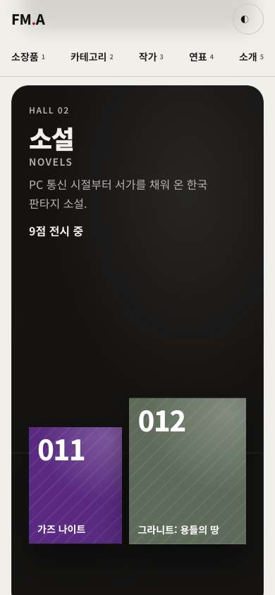 |

| Storybook                                                                  |
| -------------------------------------------------------------------------- |
| 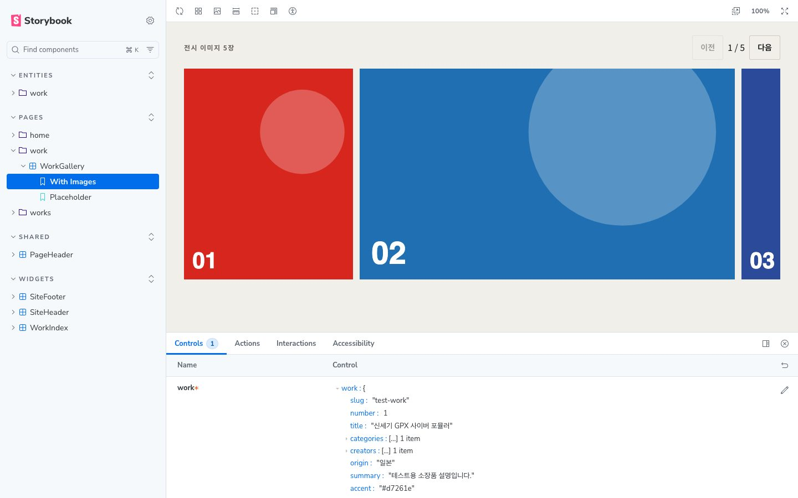 |

## 주요 기능

| 메뉴      | 내용                                                                                                       |
| --------- | ---------------------------------------------------------------------------------------------------------- |
| 홈        | 밀어서 넘기는 전시 띠, 번호순 소장품 목록, 스크롤하면 화면 가득 펼쳐지고 지나가며 물러나는 카테고리 전시관 |
| 소장품    | 제목·원제·줄임말·작가 검색과 분류(여러 개) 필터, 조건을 주소에 남겨 공유                                   |
| 작품 상세 | 만든 사람과 작가 페이지 연결, 전시 메모, 스와이프 갤러리와 크게 보기, 이전·다음 소장품                     |
| 카테고리  | 게임, 소설, 라이트 노벨, 만화·웹툰, 애니메이션, 피규어, 프라모델                                           |
| 작가      | 박성우, 박진환, 이경영, 이영도의 소개와 소장품                                                             |
| 연표      | 처음 나온 해 순서로 따라가는 1987년부터의 대장정                                                           |
| 정적 API  | `/api/works.json`, `/api/works/{slug}.json`, `/api/categories.json`, `/api/authors.json`                   |

소장품 29점(애니메이션·게임·라이트 노벨·한국 판타지 소설·한국 만화와 웹툰·피규어·프라모델), 라이트·다크·시스템 테마, 키보드와 화면 낭독기 사용을 지원합니다.

## 기술 스택


| 구분       | 사용 기술                                                                                                                                   |
| ---------- | ------------------------------------------------------------------------------------------------------------------------------------------- |
| 프레임워크 | React Router 8(프레임워크 모드, 정적 사전 렌더링), React 19, TypeScript 7                                                                   |
| UI·접근성  | React Aria Components, CSS Modules, Noto Sans KR, CSS scroll-snap 스와이프                                                                  |
| API        | OpenAPI 3.1 문서와 openapi-typescript 타입 생성, 정적 JSON API                                                                              |
| 모니터링   | Sentry(`@sentry/react-router`), web-vitals                                                                                                  |
| 성능 예산  | Lighthouse CI, size-limit, 반응형 이미지(`srcset`·`fetchpriority`), sharp WebP 변환                                                         |
| 품질       | ESLint(`eslint-plugin-jsx-a11y` strict), Steiger(FSD), Prettier, Vitest + Testing Library, Storybook 10 스토리 테스트, Playwright + axe E2E |
| 배포       | Vercel, GitHub Actions, Dependabot                                                                                                          |

## 시작하기

Node.js 26(`.nvmrc`)과 pnpm 12가 필요합니다.

```bash
nvm use
corepack enable pnpm
pnpm install
pnpm dev    # http://localhost:5173
```

| 명령                                   | 설명                                                                      |
| -------------------------------------- | ------------------------------------------------------------------------- |
| `pnpm build` / `preview`               | 정적 사전 렌더링 빌드 / 빌드 결과 미리보기(`http://localhost:4173`)       |
| `pnpm build:all`                       | 앱과 Storybook(`/storybook`)을 함께 빌드                                  |
| `pnpm media:download` / `media:build`  | 작품 이미지를 `~/Documents/Fanatic-Museum/`에 받기 / 화면용 변환본 만들기 |
| `pnpm lint` / `lint:fsd` / `typecheck` | ESLint / FSD 검사 / 타입 검사                                             |
| `pnpm test` / `test:e2e`               | 단위·스토리 테스트 / 프로덕션 빌드 E2E                                    |
| `pnpm size` / `lhci`                   | 번들 크기 예산 / Lighthouse 예산                                          |
| `pnpm api:types`                       | OpenAPI 문서에서 타입 다시 생성                                           |

## 프로젝트 구조

```
openapi/         정적 API 문서(OpenAPI 3.1)
scripts/media/   이미지 다운로드·변환 스크립트와 작품별 출처
e2e/             E2E 테스트 (접근성·레이아웃·이동·API)
src/
├─ app/          루트 레이아웃, 라우트, 전역 스타일, 모니터링
├─ pages/        홈, 소장품, 작품, 카테고리, 작가, 연표, 소개
├─ widgets/      헤더(테마 전환), 푸터, 소장품 목록
├─ entities/     소장품, 카테고리, 작가
└─ shared/       API 타입, 설정, 유틸리티, 공용 UI
```

## 문서

| 문서                               | 내용                                                                    |
| ---------------------------------- | ----------------------------------------------------------------------- |
| [개발 가이드](docs/development.md) | FSD 구조, 사전 렌더링, OpenAPI, 이미지 보관함, 모니터링, 접근성, 테스트 |
| [버전 기록](CHANGELOG.md)          | 버전별 변경 내용                                                        |

## 출처

화면에는 출처를 적지 않고 여기에 모읍니다. 소개 화면의 '이미지에 대하여'가 이곳으로 잇습니다.

| 자료                             | 저작자                                                                | 사용 허락                                       | 원본                                                                                                                                                                                                             |
| -------------------------------- | --------------------------------------------------------------------- | ----------------------------------------------- | ---------------------------------------------------------------------------------------------------------------------------------------------------------------------------------------------------------------- |
| Noto Sans KR 글꼴 (가변)         | Adobe                                                                 | SIL OFL 1.1                                     | [Google Fonts](https://fonts.google.com/specimen/Noto+Sans+KR)                                                                                                                                                   |
| 작품 이미지 (로컬 보관함에만 둠) | 각 작품의 저작권자                                                    | 개인 보관용. 공개 사이트와 저장소에는 싣지 않음 | yande.re, Konachan, Safebooru, pixiv, Steam 공식 스크린샷, 교보문고 표지, 네이버 웹툰, HobbyLink Japan 상품 사진, BoardGameGeek 갤러리 (작품별 정의: [`scripts/media/sources.json`](scripts/media/sources.json)) |
| 자리 표시 그래픽                 | 직접 만든 자료 (작품 번호와 대표색으로 코드에서 그림)                 | —                                               | —                                                                                                                                                                                                                |
| 소장품 소개 글                   | 직접 쓴 글 (한국 작가 작품의 연도·연재처는 나무위키 작가 문서로 확인) | —                                               | —                                                                                                                                                                                                                |

공개 사이트와 위 화면 스크린샷에는 작품 이미지 대신 자리 표시 그래픽만 나옵니다. 이미지마다의 원본 페이지는 로컬 보관함의 목록(`manifest.jsonl`)에만 있어 이 표에 두지 않고, 로컬에서 이미지를 볼 때 뷰어의 '원본 출처'로 보여 줍니다.
