# Fanatic Museum - 서브컬처 대장정

[](https://github.com/ryushin01/Fanatic-Museum/actions/workflows/ci.yml)


애니메이션, 게임, 라이트 노벨, 판타지 소설, 만화·웹툰, 피규어, 프라모델까지. 한 사람의 서브컬처 대장정을 소장품처럼 번호를 붙여 전시하는 박물관입니다.

**[전시실 바로 보기](https://fanatic-museum-ryushin01.vercel.app/)** · [Storybook](https://fanatic-museum-ryushin01.vercel.app/storybook/index.html) · [정적 API](https://fanatic-museum-ryushin01.vercel.app/api/works.json)

> **프로젝트 상태:** 포트폴리오 프로젝트입니다. 작품 이미지의 저작권은 각 저작권자에게 있어, 고화질 이미지는 관리자 컴퓨터에만 보관하고 공개 사이트에는 작품 번호와 대표색으로 만든 자리 표시 그래픽을 보여 줍니다. 이미지를 받는 곳과 글꼴의 출처는 아래 [출처](#출처)에 모았습니다.

## 화면

| 홈                                                                                               | 소장품 목록                                                              |
| ------------------------------------------------------------------------------------------------ | ------------------------------------------------------------------------ |
| 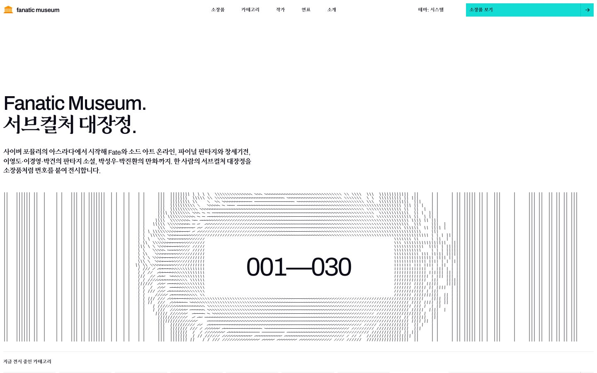 | 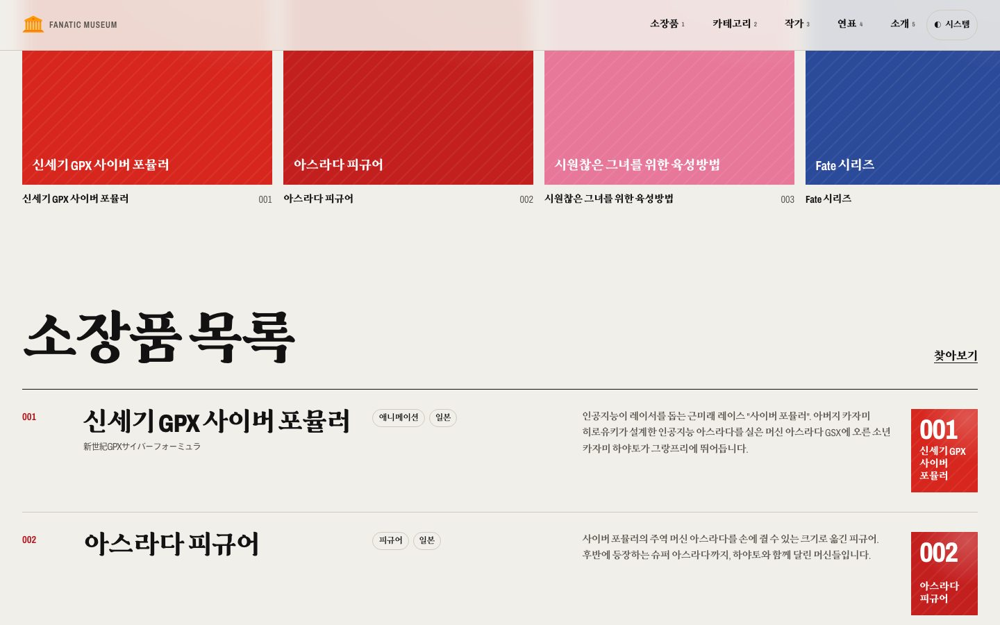 |

| 작품 상세                                                                      | 소장품 찾기                                                                       |
| ------------------------------------------------------------------------------ | --------------------------------------------------------------------------------- |
| 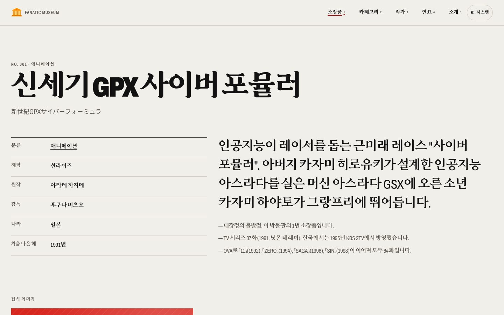 | 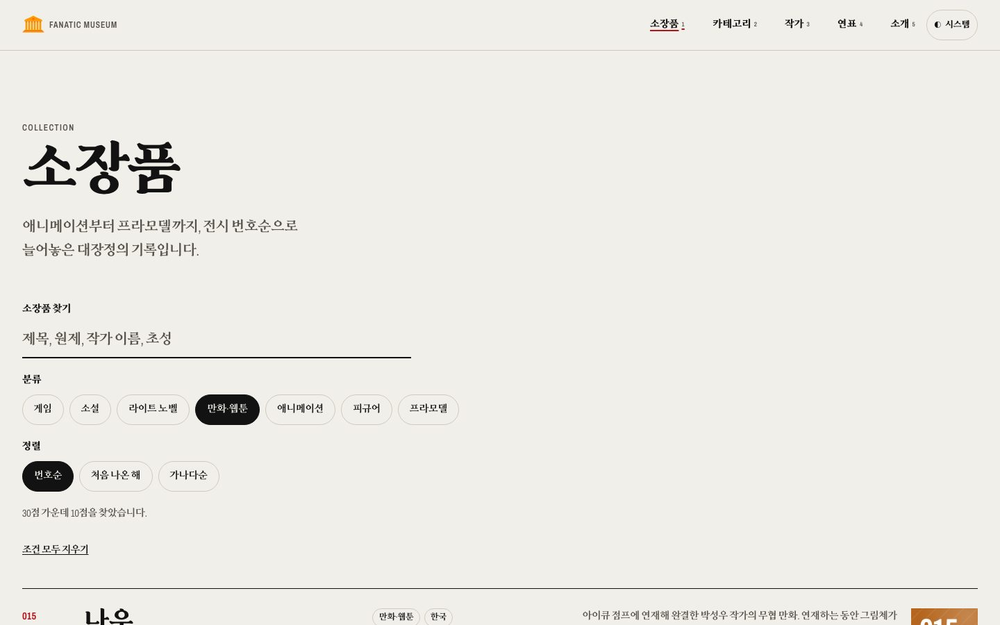 |

| 대장정 연표                                                       | 작가                                                                                |
| ----------------------------------------------------------------- | ----------------------------------------------------------------------------------- |
| 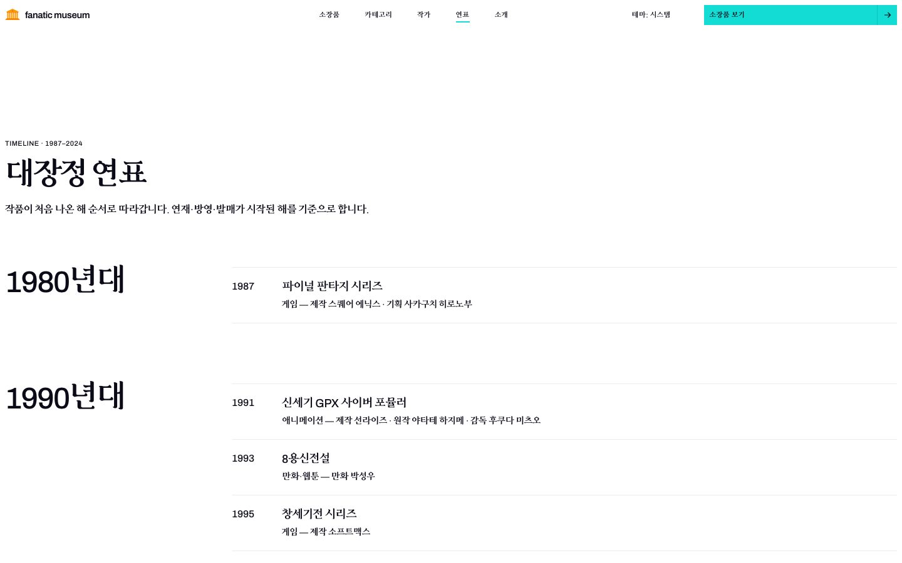 | 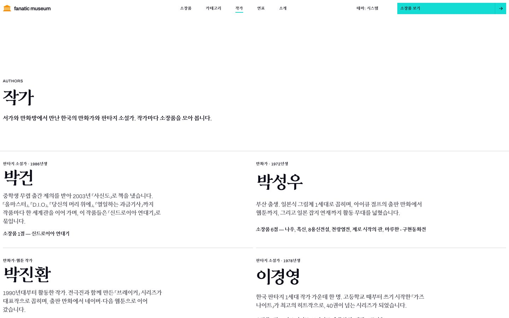 |

| 모바일 홈                                                                                              | 모바일 작품 상세                                                                    | 모바일 다크 모드                                                                           |
| ------------------------------------------------------------------------------------------------------ | ----------------------------------------------------------------------------------- | ------------------------------------------------------------------------------------------ |
| 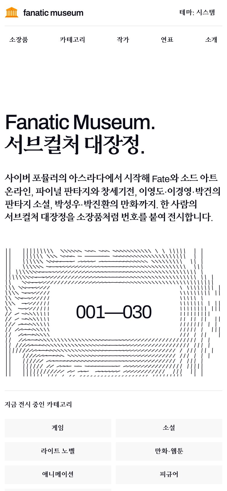 | 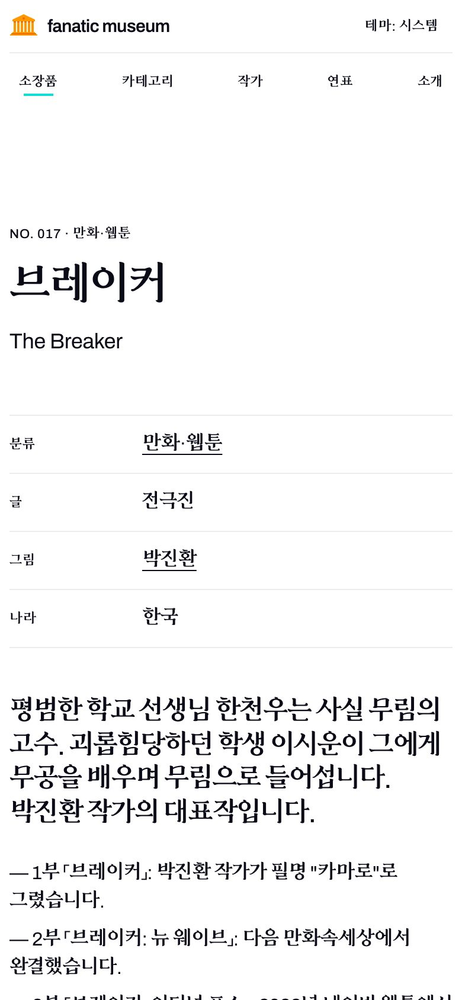 | 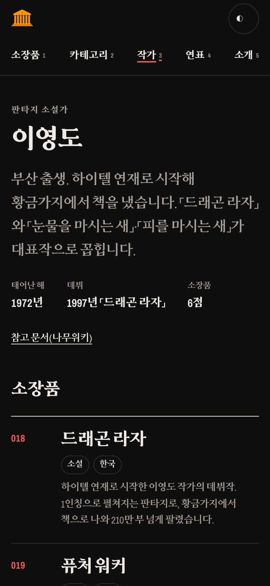 |

| 홈 전시관                                                                                                | 모바일 전시관                                                                                     |
| -------------------------------------------------------------------------------------------------------- | ------------------------------------------------------------------------------------------------- |
| 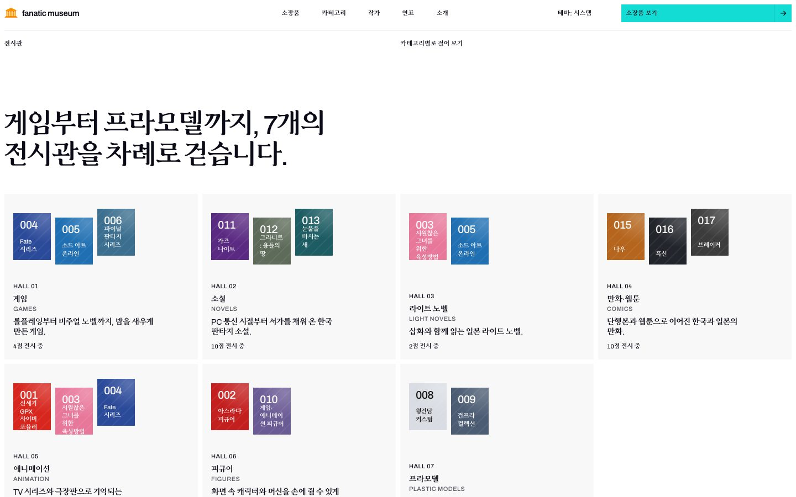 | 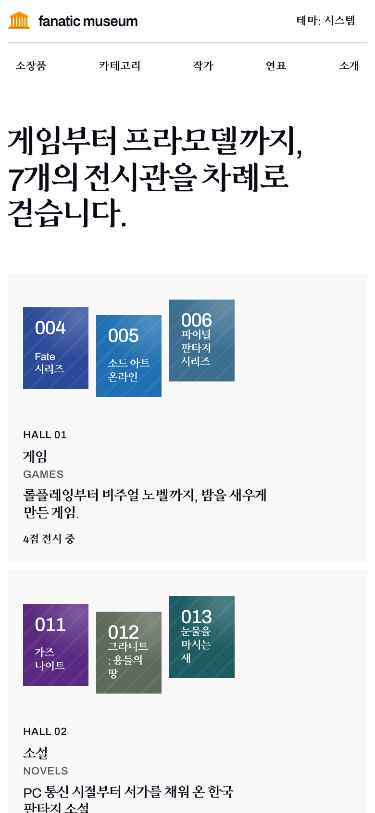 |

| Storybook                                                                  |
| -------------------------------------------------------------------------- |
| 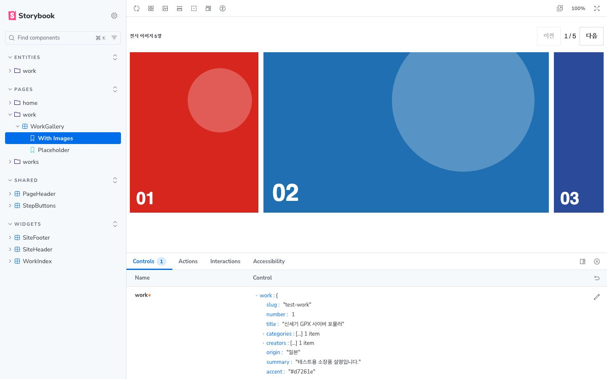 |

## 주요 기능

| 메뉴      | 내용                                                                                                              |
| --------- | ----------------------------------------------------------------------------------------------------------------- |
| 홈        | 마우스를 따라 휘는 선 그림, 카테고리 칩, 밀어서 넘기는 전시 띠, 숫자 줄, 번호순 소장품 목록, 카테고리 전시관 카드 |
| 소장품    | 제목·원제·줄임말·작가 검색(초성도), 분류(여러 개) 필터, 번호·처음 나온 해·가나다 정렬, 조건을 주소에 남겨 공유    |
| 작품 상세 | 만든 사람과 작가 페이지 연결, 전시 메모, 스와이프 갤러리와 크게 보기, 이전·다음 소장품                            |
| 카테고리  | 게임, 소설, 라이트 노벨, 만화·웹툰, 애니메이션, 피규어, 프라모델                                                  |
| 작가      | 박건, 박성우, 박진환, 이경영, 이영도의 소개와 소장품                                                              |
| 연표      | 처음 나온 해 순서로 따라가는 1987년부터의 대장정                                                                  |
| 정적 API  | `/api/works.json`, `/api/works/{slug}.json`, `/api/categories.json`, `/api/authors.json`                          |

소장품 30점(애니메이션·게임·라이트 노벨·한국 판타지 소설·한국 만화와 웹툰·피규어·프라모델), 라이트·다크·시스템 테마, 키보드와 화면 낭독기 사용을 지원합니다. 링크를 공유하면 작품마다 미리보기 그림이 함께 나옵니다.

## 기술 스택


| 구분       | 사용 기술                                                                                                                                   |
| ---------- | ------------------------------------------------------------------------------------------------------------------------------------------- |
| 프레임워크 | React Router 8(프레임워크 모드, 정적 사전 렌더링), React 19, TypeScript 7                                                                   |
| UI·접근성  | React Aria Components, CSS Modules, 웹 폰트(Archivo·국립박물관문화재단 클래식체, 공유 이미지는 MedievalSharp), CSS scroll-snap 스와이프     |
| API        | OpenAPI 3.1 문서와 openapi-typescript 타입 생성, 정적 JSON API                                                                              |
| 검색·공유  | canonical·Open Graph·JSON-LD(schema.org), 웹 앱 매니페스트, sitemap·robots                                                                  |
| 모니터링   | Sentry(`@sentry/react-router`), web-vitals                                                                                                  |
| 성능 예산  | Lighthouse CI, size-limit, 반응형 이미지(`srcset`·`fetchpriority`), sharp WebP 변환                                                         |
| 품질       | ESLint(`eslint-plugin-jsx-a11y` strict), Steiger(FSD), Prettier, Vitest + Testing Library, Storybook 10 스토리 테스트, Playwright + axe E2E |
| 배포       | Vercel(보안 헤더·CSP), GitHub Actions, Dependabot                                                                                           |

## 시작하기

Node.js 26(`.nvmrc`)과 pnpm 12가 필요합니다.

```bash
nvm use
corepack enable pnpm
pnpm install
pnpm dev    # http://localhost:5173
```

`.env` 없이 clone → install → `pnpm dev`, `pnpm build && pnpm preview`가 바로 돕니다. 비밀값이 필요한 곳은 오류 수집(Sentry, `VITE_SENTRY_DSN`)뿐이고, 비워 두면 Sentry를 받지 않습니다.

### 오프라인으로 보기

사이트는 네트워크가 끊겨도 그대로 보입니다. 소장품 데이터는 빌드할 때 HTML과 정적 JSON(`/api/works.json`)에 들어가고, 글꼴·아이콘은 같은 사이트에서 주며(외부 CDN 없음), 작품 이미지는 배포본에 없고 대표색과 번호로 그린 자리 표시 그래픽을 씁니다(저작권 때문, [소장품 이미지](docs/development.md#소장품-이미지)). 바깥 주소는 README·작가 페이지의 링크(나무위키 등)뿐이고, 화면을 그리는 데 쓰지 않습니다.

```bash
pnpm build && pnpm preview                    # 한 번 빌드한 뒤에는 네트워크 없이 http://localhost:4173
pnpm exec playwright test e2e/offline.spec.ts # localhost 밖 요청을 모두 막고 주요 화면을 검사
```

| 명령                                   | 설명                                                                              |
| -------------------------------------- | --------------------------------------------------------------------------------- |
| `pnpm build` / `preview`               | 정적 사전 렌더링 빌드 / 빌드 결과 미리보기(`http://localhost:4173`)               |
| `pnpm build:all`                       | 앱과 Storybook(`/storybook`)을 함께 빌드                                          |
| `pnpm media:download` / `media:build`  | 작품 이미지를 `~/Documents/Archive/Fanatic-Museum/`에 받기 / 화면용 변환본 만들기 |
| `pnpm lint` / `lint:fsd` / `typecheck` | ESLint / FSD 검사 / 타입 검사                                                     |
| `pnpm test` / `test:e2e`               | 단위·스토리 테스트 / 프로덕션 빌드 E2E(오프라인 검사 포함)                        |
| `pnpm size` / `lhci`                   | 번들 크기 예산 / Lighthouse 예산                                                  |
| `pnpm api:types`                       | OpenAPI 문서에서 타입 다시 생성                                                   |
| `pnpm og:build`                        | 공유 미리보기 이미지(`public/og/`) 다시 만들기                                    |

## 프로젝트 구조

```
openapi/         정적 API 문서(OpenAPI 3.1)
scripts/media/   이미지 다운로드·변환 스크립트와 작품별 출처
e2e/             E2E 테스트 (접근성·레이아웃·이동·API·오프라인)
src/
├─ app/          루트 레이아웃, 라우트, 전역 스타일, 모니터링
├─ pages/        홈, 소장품, 작품, 카테고리, 작가, 연표, 소개
├─ widgets/      헤더(테마 전환), 푸터, 소장품 목록
├─ entities/     소장품, 카테고리, 작가
└─ shared/       API 타입, 설정, 유틸리티, 공용 UI
```

## 문서

| 문서                                           | 내용                                                                                 |
| ---------------------------------------------- | ------------------------------------------------------------------------------------ |
| [개발 가이드](docs/development.md)             | FSD 구조, 사전 렌더링, 글꼴, 검색·공유 정보, 이미지 보관함, 모니터링, 접근성, 테스트 |
| [시퀀스 다이어그램](docs/sequence-diagrams.md) | 빌드할 때 사전 렌더링과 이미지, 검색 조건을 주소에 남기기, 정적 JSON API             |
| [버전 기록](CHANGELOG.md)                      | 버전별 변경 내용                                                                     |

## 웹 폰트

| 글꼴                        | 쓰는 곳                 | 굵기         | 저작자              | 라이선스                             | 원본                                                                                                           |
| --------------------------- | ----------------------- | ------------ | ------------------- | ------------------------------------ | -------------------------------------------------------------------------------------------------------------- |
| Archivo                     | 영문·숫자 (제목·본문)   | 100~900 가변 | Omnibus-Type        | SIL OFL 1.1                          | [Google Fonts](https://fonts.google.com/specimen/Archivo) · [Fontsource](https://fontsource.org/fonts/archivo) |
| MedievalSharp               | 공유 이미지의 영문 제목 | 400          | Wojciech Kalinowski | SIL OFL 1.1                          | [Google Fonts](https://fonts.google.com/specimen/MedievalSharp)                                                |
| 국립박물관문화재단 클래식체 | 한글 (제목·본문)        | 500·700      | 국립박물관문화재단  | 무료(배포·웹 임베딩 가능, 수정 금지) | [눈누](https://noonnu.cc/font_page/326)                                                                        |

모두 같은 사이트에서 제공합니다(외부 글꼴 CDN 없음). 클래식체는 수정할 수 없어 원본 파일을 그대로 쓰고, 글자가 중간에 바뀌지 않게 다 받을 때까지 로딩 화면으로 덮습니다(동작은 [개발 가이드](docs/development.md#글꼴)). 라이선스 요지는 `src/app/fonts/museum-classic/LICENSE.txt`에 있습니다.

## 출처

화면에는 출처를 적지 않고 여기에 모읍니다. 소개 화면의 '이미지에 대하여'가 이곳으로 잇습니다.

| 자료                             | 저작자                                                                | 사용 허락                                               | 원본                                                                                                                                                                                                             |
| -------------------------------- | --------------------------------------------------------------------- | ------------------------------------------------------- | ---------------------------------------------------------------------------------------------------------------------------------------------------------------------------------------------------------------- |
| 박물관 아이콘 (파비콘·로고)      | Icons8 (Flat Color Icons)                                             | MIT ([사본](public/brand/LICENSE-flat-color-icons.txt)) | [icons8/flat-color-icons](https://github.com/icons8/flat-color-icons)                                                                                                                                            |
| 작품 이미지 (로컬 보관함에만 둠) | 각 작품의 저작권자                                                    | 개인 보관용. 공개 사이트와 저장소에는 싣지 않음         | yande.re, Konachan, Safebooru, pixiv, Steam 공식 스크린샷, 교보문고 표지, 네이버 웹툰, HobbyLink Japan 상품 사진, BoardGameGeek 갤러리 (작품별 정의: [`scripts/media/sources.json`](scripts/media/sources.json)) |
| 자리 표시 그래픽·공유 이미지     | 직접 만든 자료 (작품 번호와 대표색, 사이트 글꼴로 그림)               | —                                                       | —                                                                                                                                                                                                                |
| 소장품 소개 글                   | 직접 쓴 글 (한국 작가 작품의 연도·연재처는 나무위키 작가 문서로 확인) | —                                                       | —                                                                                                                                                                                                                |

공개 사이트와 위 화면 스크린샷에는 작품 이미지 대신 자리 표시 그래픽만 나옵니다. 이미지마다의 원본 페이지는 로컬 보관함의 목록(`manifest.jsonl`)에만 있어 이 표에 두지 않고, 로컬에서 이미지를 볼 때 뷰어의 '원본 출처'로 보여 줍니다.
