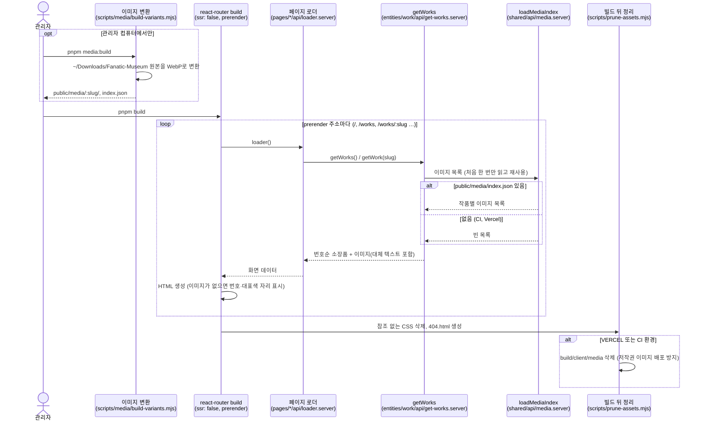
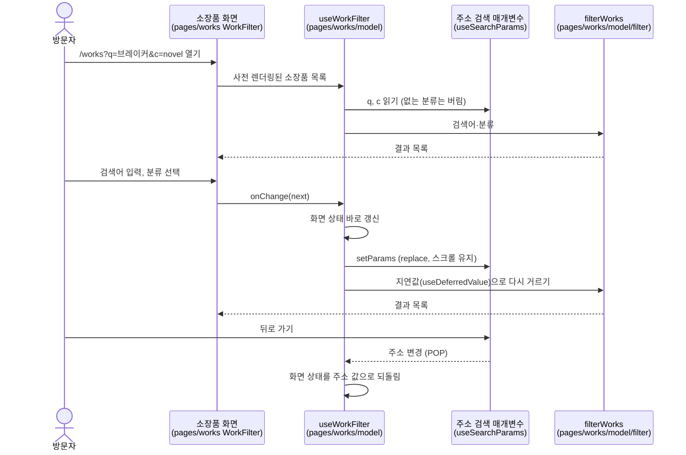
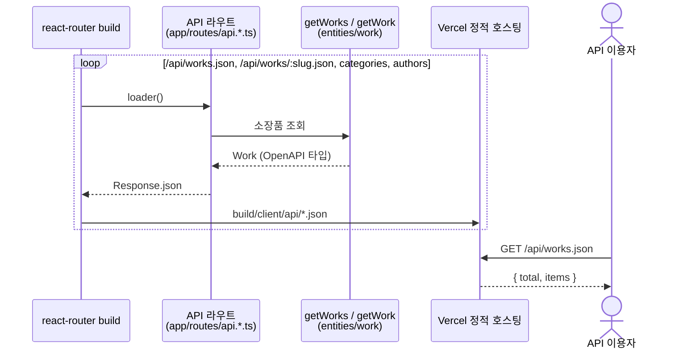

# 시퀀스 다이어그램

서버 없이 정적 파일로 배포하는 전시실의 주요 흐름입니다. 데이터는 빌드할 때 한 번 읽고, 방문자의 브라우저는 미리 만든 HTML과 JSON만 받습니다.

## 1. 빌드할 때 사전 렌더링과 이미지

`react-router.config.ts`의 `prerender`에 적힌 주소마다 로더를 한 번씩 실행해 HTML을 만듭니다. 저작권 이미지는 관리자 컴퓨터에만 있으므로, 배포 빌드에서는 이미지 목록이 비어 자리 표시 그래픽이 그려집니다.

## 2. 소장품 검색 조건을 주소에 남기기

입력은 화면 상태에 먼저 반영하고 주소(`?q=&c=`)는 뒤따라 맞춥니다. 결과 목록은 지연값으로 걸러 빠르게 입력해도 버벅이지 않습니다.

## 3. 정적 JSON API

API 주소도 사전 렌더링 목록에 있어 빌드할 때 JSON 파일로 만들어집니다. 타입은 `openapi/archive.yaml`에서 생성하고, CI가 생성 결과와 커밋된 파일이 같은지 확인합니다. 사전 렌더링 목록에는 있는 소장품만 들어가므로, 없는 소장품 주소는 정적 호스팅의 404가 됩니다.

